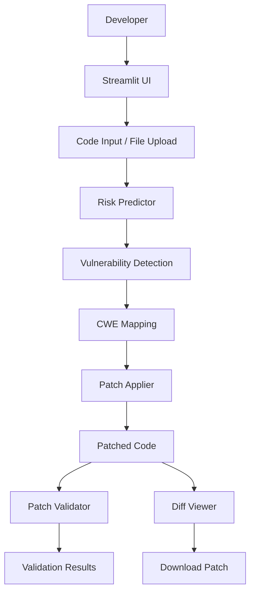
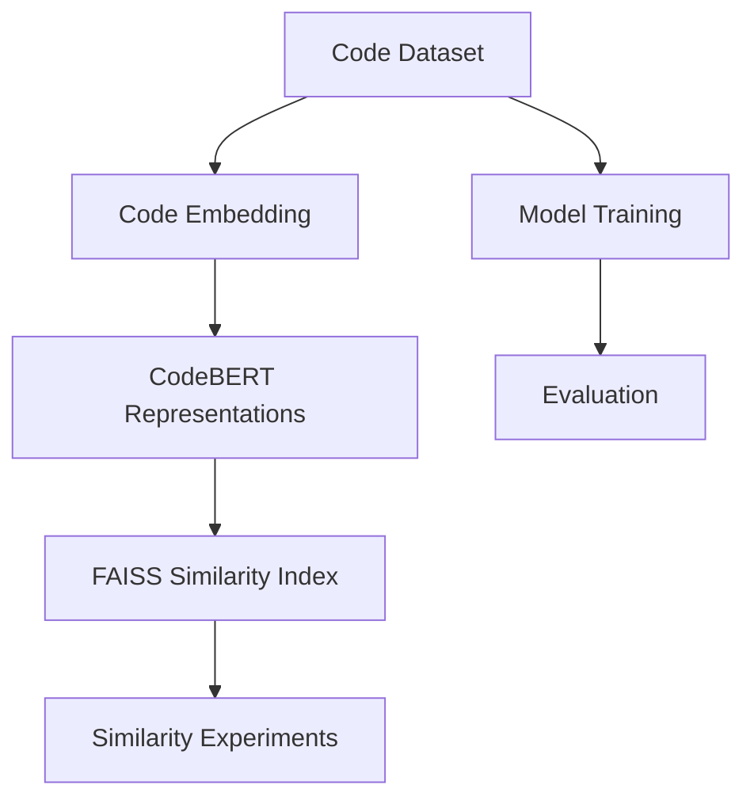
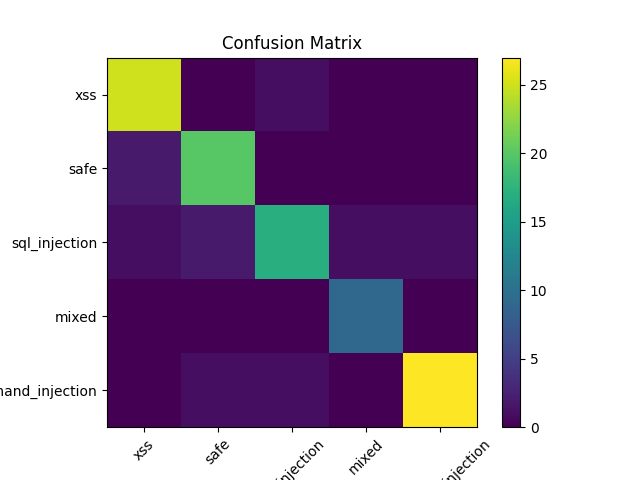
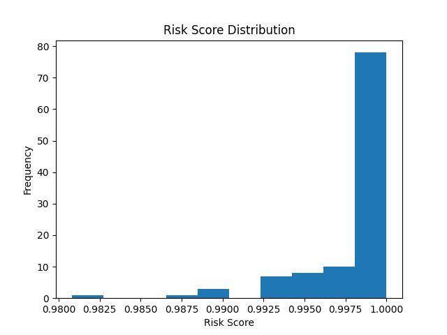
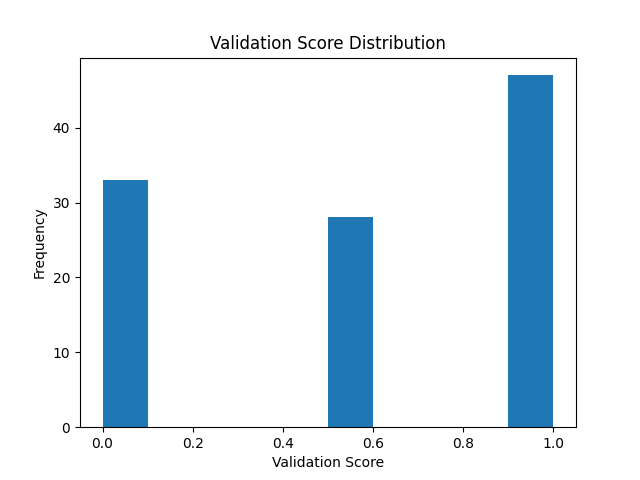

# ShadowPatchAI

### AI-Assisted Vulnerability Detection and Secure Code Remediation

ShadowPatchAI is a research-oriented application security project exploring how machine learning, code analysis and automated patch suggestions can help developers identify and address common insecure coding patterns.

The project combines a Streamlit interface, vulnerability detection, CWE mapping, risk assessment, automated patch transformations and static validation. It also includes experimental CodeBERT embeddings, FAISS similarity search and model-training utilities.

> **Project Status:** Prototype / Active Development. Generated patches are suggestions and must be reviewed and tested before use in real applications.

## 🚀 Key Features

- **Vulnerability Detection:** Identifies selected patterns associated with SQL injection, command injection, XSS, weak randomness, hardcoded credentials and path traversal.
- **CWE Mapping:** Associates supported vulnerability categories with relevant CWE identifiers.
- **Risk Assessment:** Provides indicative severity information for detected issues.
- **Automated Patching:** Applies predefined code transformations for supported vulnerability patterns.
- **Patch Validation:** Performs static checks on selected vulnerability patterns after patching.
- **Diff Visualization:** Displays differences between original and patched code.
- **Code Upload:** Accepts Python and text files through the Streamlit interface.
- **CodeBERT Experiments:** Includes code representation and model-training experiments.
- **FAISS Integration:** Includes utilities for embedding similarity indexing and retrieval.

## 🏗️ System Architecture

### Application Workflow



### Experimental Machine Learning Workflow



The experimental ML components are separate from the current Streamlit detection workflow.

## 🛠️ Technology Stack

| Technology | Purpose |
|---|---|
| Python | Core development |
| Streamlit | Interactive application |
| CodeBERT | Code representation experiments |
| Sentence Transformers | Code embeddings |
| FAISS | Similarity search |
| PyTorch | Model experimentation |
| Scikit-learn | ML utilities |
| NumPy & Pandas | Data processing |
| Matplotlib | Evaluation visualizations |

## 📂 Project Structure

```text
ShadowPatchAI/
│
├── app/
│   └── streamlit_app.py
│
├── data/
│   ├── raw/
│   ├── processed/
│   ├── synthetic/
│   └── preprocess_dataset.py
│
├── dataset/
│
├── docs/
│
├── experiments/
│
├── src/
│   ├── api/
│   ├── embedding/
│   ├── explainability/
│   ├── ml/
│   ├── patch_generation/
│   ├── risk_analysis/
│   ├── security/
│   ├── ui/
│   ├── utils/
│   └── validation/
│
├── tests/
│
├── requirements.txt
├── confusion_matrix.png
├── risk_distribution.png
└── validation_distribution.png
```

## ⚙️ Installation and Setup

### Prerequisites

- Python 3.10 or newer
- Git
- Internet connection for package installation

### 1. Clone the Repository

```bash
git clone https://github.com/SohamK04/ShadowPatchAI.git
cd ShadowPatchAI
```

### 2. Create a Virtual Environment

**Windows PowerShell**

```powershell
python -m venv .venv
.\.venv\Scripts\Activate.ps1
```

**Linux / macOS**

```bash
python3 -m venv .venv
source .venv/bin/activate
```

### 3. Install Dependencies

```bash
python -m pip install --upgrade pip
pip install -r requirements.txt
pip install streamlit
```

For separate CodeBERT experiments:

```bash
pip install torch transformers matplotlib
```

### 4. Run the Application

```bash
streamlit run app/streamlit_app.py
```

Open the URL displayed in your terminal, usually:

```text
http://localhost:8501
```

## 💻 How to Use

1. Launch the Streamlit application.
2. Paste Python code into the editor or upload a supported file.
3. Select **Analyze & Fix**.
4. Review detected vulnerability categories.
5. Inspect the suggested patched code.
6. Compare original and modified code using the diff viewer.
7. Review static validation results.
8. Download the proposed patched code if appropriate.

Always manually review and test generated patches before integrating them into an application.

## 🔍 Vulnerability Categories

| Vulnerability | CWE |
|---|---|
| SQL Injection | CWE-89 |
| Cross-Site Scripting | CWE-79 |
| Command Injection | CWE-78 |
| Hardcoded Credentials | CWE-798 |
| Path Traversal | CWE-22 |
| Weak Randomness | CWE-330 |
| Unsafe Execution | Pattern-based |
| Unsafe File Handling | Pattern-based |

Coverage is limited to the patterns currently implemented.

## 📊 Evaluation and Visualizations

The repository includes experimental evaluation utilities and generated visualizations.

### Confusion Matrix



### Risk Distribution



### Validation Distribution



Evaluation results should be interpreted alongside the dataset, labeling strategy and experimental methodology.

## 🔐 Security Considerations and Limitations

- Detection currently relies on selected code patterns and may produce false positives or miss vulnerabilities.
- Automated patches use predefined transformations and are not guaranteed to preserve program behavior.
- Patch validation uses static pattern checks rather than comprehensive execution-based verification.
- CodeBERT and FAISS components are experimental and are not currently the primary Streamlit detection pipeline.
- This project should not be used as the sole security control for production applications.

## 🗺️ Roadmap

- [ ] Improve semantic vulnerability detection.
- [ ] Expand programming-language support.
- [ ] Improve CWE classification and vulnerability localization.
- [ ] Develop context-aware patch generation.
- [ ] Introduce stronger patch validation and automated testing.
- [ ] Integrate embedding retrieval into the main detection workflow.
- [ ] Improve false-positive and false-negative handling.
- [ ] Introduce automated GitHub code-review workflows.
- [ ] Improve reproducibility and test coverage.

## 🤝 Contributing

Contributions, bug reports and suggestions are welcome.

1. Fork the repository.
2. Create a feature branch.
3. Implement your changes.
4. Add or update relevant tests.
5. Submit a pull request with a clear explanation.

Please do not commit API keys, credentials or private source code.

## 👨‍💻 Maintainer

**Soham Kolhe**

Creator and Primary Maintainer

- GitHub: [@SohamK04](https://github.com/SohamK04)
- Repository: [ShadowPatchAI](https://github.com/SohamK04/ShadowPatchAI)

## 📄 License

A license has not yet been added to this repository. Consider adding an appropriate open-source license before inviting external reuse and contributions.
